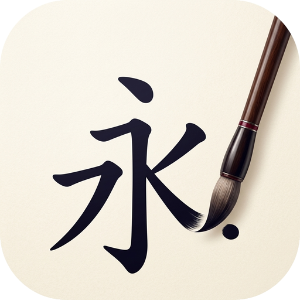

# Inkwell



Kendi hanzi havuzunu kur, aralıklı tekrarla ezberle. Çevrimdışı çalışır, veri
cihazdan çıkmaz.

Ders kitabında her bölüm sonu çıkan yeni karakterleri kendi listene ekleyip
aralıklı tekrar (spaced repetition) ile çalışmak için yapıldı. Çince klavye
gerektirmez.

---

## Ne yapar

**Kart havuzu.** Karakterleri destelere (bölümlere) ayırarak biriktirirsin.

**Üç yönlü çalışma.** Her kayıt için ayrı ayrı takip edilen üç kart üretilir:

| Tür | Soru | Yazdığın | Ölçtüğü |
|---|---|---|---|
| Okunuş | 老师 | `lao3shi1` | karakter → ses |
| Anlam | lǎoshī | `teacher` | ses → anlam |
| Üretim | teacher | `lao3shi1` + karakteri hatırla | anlam → üretim |
| Yazma | teacher · lǎoshī | karakteri kalemle çizersin | elle üretim |

**Kategoriler ayrı çalışılır.** Çalış ekranındaki seçiciyle yalnız bir türü
çalışabilirsin. Karakteri tanımaya çalışmakla kalemle yazmak farklı işler;
aynı oturumda karışınca ikisi de yarım kalıyor. "Karışık" seçeneği de duruyor.

Yani 100 karakter girince 300 kart olur, tek tek kart hazırlamazsın.

Üçünde de cevabı **yazarsın**. Kafadan cevaplayıp kendine not vermek
güvenilir değil: insan bildiğini sanır. Yazılan cevap ölçülebilir.

**Cevap doğruya yakınlığına göre değerlendirilir.** Bir hecenin tonunu
kaçırmakla sözcüğü hiç bilmemek aynı şey değil:

| Cevap | Sonuç |
|---|---|
| `lao3shi1` | Doğru |
| `lao2shi1` | Ton yanlış — hangi hece olduğu işaretlenir |
| `lao3si1` | Neredeyse (bir harf sapma) |
| başka bir şey | Yanlış |

Anlam kartlarında eşleşme esnektir: kayıttaki karşılıklardan herhangi biri
tutarsa doğru sayılır ("a teacher" ↔ "teacher; instructor"). Boş bırakıp
geçmek "bilmiyorum" demektir.

Klavye: **Enter** cevabı kontrol eder, tekrar **Enter** sonraki karta geçer.

Karakteri klavyeyle yazdıramadığımız için (Çince klavye gerekir) Üretim
kartında karakterin doğrulaması sende: hatırlamadıysan düşük not verirsin.

**Yazma kartı** bu boşluğu dolduruyor. Karakteri 米字格 kılavuz karesine
strok strok çizersin; her strok beklenen yolla karşılaştırılır, yanlış sırada
çizersen kabul edilmez, üç hatadan sonra o strok ipucu olarak belirir.
Not hata sayısından gelir. Dokunmatik ekran ve kalem gerektirdiği için
varsayılan olarak kapalı — tablette Ayarlar'dan açarsın.

Strok verisi 9.574 karakteri kapsıyor. Kapsamayan bir karakterde kart elle
değerlendirmeye düşer.

**Havuzun tamamı, karışık sırayla.** Çalışmaya başlayınca seçtiğin
kategorideki bütün kartlar karıştırılıp baştan sona gelir. Cevabı yazarsın,
sonuç görünür, oka basıp devam edersin. Havuz bitince oturum biter.

Aralıklı tekrar verisi arka planda yine birikiyor (her cevap kartın aralığını
güncelliyor) ama hangi kartın çıkacağına karışmıyor. Not sorulmuyor: cevap
zaten yazılıp ölçüldüğü için doğruya yakınlıktan türetiliyor.

**Çince klavye gerekmez.** Yalnız okunuşu yazarsın, karakter ve anlam kendi
gelir:

- **Sözlükten:** `ni3` yazıp Enter'a basarsın, 你 eklenir. `ni3` ⏎ `hao3` ⏎
  diye aralıksız girebilirsin. Başka bir karakter istiyorsan listeden seçersin.
- **Toplu yapıştır:** her satıra bir okunuş (`lao3shi1`). Ton işaretli yazım
  (`lǎoshī`) da, karakterin kendisi de kabul edilir. Kendi anlamını yazmak
  istersen okunuştan sonra eklersin.
- **Elle:** üç alanı kendin doldurursun.

Aynı okunuşta birden çok karakter varsa en yaygını seçilir; toplu önizlemede
açılır listeden değiştirebilirsin.

Ton işaretleri de aynı mantıkla: `hao3` yazarsın, `hǎo` görürsün. Cevap
denetiminde her iki yazım da kabul edilir, ama ton yanlışsa kart yanlış sayılır.

**Çevrimdışı.** Uygulama ve 124.000 kayıtlık CC-CEDICT sözlüğü cihazda durur.
İnternet gerekmez.

---

## Dil

Arayüz Türkçe ve İngilizce. İlk açılışta cihazın diline bakılır, Ayarlar'dan
değiştirilir. Metinler `js/i18n.js`'te; sabit olanlar `data-i18n` işaretiyle,
dinamikler `t()` ile geliyor. Kartların içeriği (senin yazdığın anlamlar)
elbette çevrilmiyor.

## Çalıştırma

### Bilgisayarda

`Inkwell.bat` dosyasına çift tıkla. Yerel sunucuyu başlatır ve uygulamayı
tarayıcıda açar. Küçültülmüş bir konsol penceresi açık kalır; kapatınca
sunucu durur.

Terminalden:

```bash
npm start
```

`index.html` dosyasını doğrudan çift tıklamak **çalışmaz**: tarayıcılar
`file://` ile açılan sayfalara modül yüklemeye ve dosya okumaya izin vermez.
Sunucu bu yüzden gerekli — sadece 127.0.0.1'i dinler, ağa açılmaz.

Chrome'da adres çubuğundaki kur simgesiyle uygulama olarak da kurabilirsin;
o zaman kendi penceresinde, sekmesiz açılır. Sunucunun yine de çalışıyor
olması gerekir.

### Tablete kurmak

Android için APK üretilir — aşağıdaki bölüme bak. Web sürümünü bir yere
yayınlayıp (örn. Vercel) tarayıcıdan "Ana ekrana ekle" ile kurmak da mümkün,
ama APK'da veri tarayıcı temizliğinden etkilenmez.

---

## Android sürümü (APK)

Uygulama Capacitor ile bir Android uygulamasına sarılır. Sunucu gerekmez,
sözlük dahil her şey APK'nın içindedir.

```bash
npm run apk
```

Çıktı: `dist/Inkwell-<sürüm>.apk`. Tablete kopyalayıp dosya yöneticisinden
açarsan kurulur (bilinmeyen kaynaklara izin vermen istenebilir).

Gereken: JDK 21 ve Android SDK (platform 36, build-tools 36). `ANDROID_HOME`
ayarlıysa betik gerisini halleder.

### İmzalama anahtarı — yedekle

İlk derlemede `android/inkwell.keystore` üretilir ve parolası
`android/keystore.properties` dosyasına yazılır. İkisi de depoya girmez.

Bu anahtar uygulamanın kimliğidir: aynı anahtarla imzalanmış yeni sürümler
tablete mevcut uygulamanın **üzerine** kurulur ve kartların korunur. Anahtar
kaybolursa güncelleme kurulamaz; uygulamayı silip yeniden kurman gerekir, o da
içindeki her şeyi siler. **Bu iki dosyayı güvenli bir yere kopyala.**

### Bilinen tuzak: uzun TEMP yolu

Java, Windows'ta NIO pipe'larını AF_UNIX soketiyle kurar ve soket yolu 108
baytlık sınıra sığmak zorundadır. `TEMP` yolu uzunsa Gradle
`Unable to establish loopback connection` diye hata verir. `tools/build-apk.mjs`
derleme sırasında kısa bir geçici dizin (`C:\Temp\inkwell-build`) kullanarak
bunu önler.

---

## Veri

Her şey tarayıcının IndexedDB'sinde, cihazda tutulur. Sunucuya hiçbir şey
gitmez, hesap yoktur.

**Cihazlar ayrı.** Tabletteki APK ile bilgisayardaki tarayıcı sürümü aynı
veriyi paylaşmaz; her birinin kendi havuzu ve kendi tekrar geçmişi olur.
Şimdilik ikisini birbirine yaklaştırmanın yolu yedek dosyasını aktarmak.
Gerçek eşitleme sıradaki işlerden.

**Yedek al.** Ayarlar → Dışa aktar bir JSON dosyası verir. İçe aktarma
birleştiricidir, silici değil: aynı kaydın iki sürümü varsa yeni olan kazanır.
İki cihazın yedeklerini üst üste yüklemek veri kaybettirmez.

Kayıtlar `updatedAt` ve silme mezar taşı taşır; ileride gerçek bir cihaz
eşitlemesi eklendiğinde mevcut veri olduğu gibi taşınabilir.

---

## Yapı

```
index.html            arayüz iskeleti
css/app.css           tema (açık/koyu, kağıt-mürekkep paleti)
js/app.js             ekranlar, oturum akışı
js/store.js           IndexedDB katmanı, yedekleme
js/srs.js             aralıklı tekrar algoritması
js/dict.js            sözlük araması
js/i18n.js            arayüz dili (tr/en)
js/pinyin.js          ton dönüşümü, hece ayırma
js/grade.js           cevabın doğruya yakınlığı
js/syllables.js       geçerli heceler (üretilmiş dosya)
js/strokes.js         strok verisi yükleme ve çözme
js/vendor/            hanzi-writer (MIT)
data/strokes.txt      strok verisi (üretilmiş, depoda yok)
data/cedict.tsv       gömülü sözlük (üretilmiş dosya)
tools/serve.mjs       yerel statik sunucu (Inkwell.bat bunu çalıştırır)
tools/build-dict.mjs  CC-CEDICT → data/cedict.tsv
brand/icon-source.jpg kaynak marka görseli
tools/make-logo.py    kaynaktan bütün ikon boyutları
tools/build-strokes.mjs  hanzi-writer-data → data/strokes.txt
tools/build-www.mjs   www/ çıktısı (Capacitor bunu paketler)
tools/build-apk.mjs   imzalama + APK derlemesi
android/              Capacitor'ın ürettiği Android projesi
sw.js                 çevrimdışı önbellek (yalnız web sürümünde)
```

Strok verisi depoda durmaz, npm paketinden üretilir:

```bash
npm install
npm run strokes
```

Sözlüğü tazelemek için:

```bash
curl -o tools/cedict.txt.gz https://www.mdbg.net/chinese/export/cedict/cedict_1_0_ts_utf-8_mdbg.txt.gz
gzip -dc tools/cedict.txt.gz > tools/cedict.txt
node tools/build-dict.mjs
```

---

## Sırada ne var

- Cihazlar arası eşitleme
- Benzer görünen karakterlerin (未/末, 己/已) birbirini bozmaması için
  çıkış zamanlarının ayrılması

---

## Marka

İkondaki karakter 永 — son stroğu fırçanın altında bitiyor.

永 hat yazısında **永字八法** olarak bilinen klasik alıştırma karakteri: sekiz
temel strok türünün hepsini içerdiği için yüzyıllardır ilk yazılan karakter
budur. Yazma pratiği yapan bir uygulama için doğru karakter. Anlamı da
"sonsuz" (Japonca okunuşu *ei*).

Bütün boyutlar tek kaynaktan üretiliyor:

```bash
npm run icons
```

## Veri kaynakları

- Sözlük: [CC-CEDICT](https://cc-cedict.org/), CC BY-SA 4.0
- Karakter sıklığı: Jun Da, *Modern Chinese Character Frequency List*
  ([hanziDB.csv](https://github.com/ruddfawcett/hanziDB.csv) üzerinden)
- Kelime seviyeleri: HSK 3.0 ([ivankra/hsk30](https://github.com/ivankra/hsk30))
- Strok verisi ve çizim: [hanzi-writer](https://hanziwriter.org/) (MIT),
  veri tabanı [Make Me a Hanzi](https://github.com/skishore/makemeahanzi)

Sıklık ve HSK verisi yalnız arama sonuçlarının sıralaması için kullanılır:
bir okunuşa karşılık gelen adaylar içinden öğrencinin muhtemelen aradığı
sözcük öne çıksın diye.
